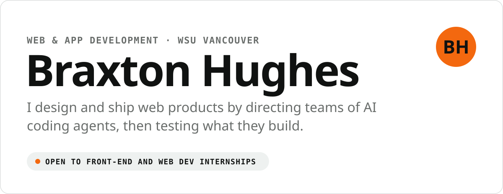
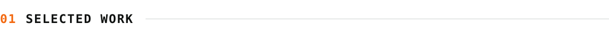
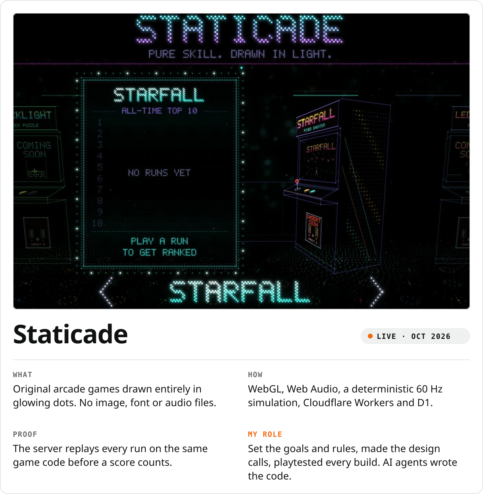
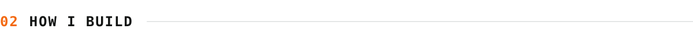
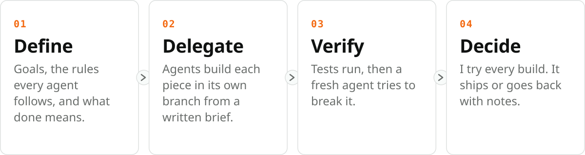
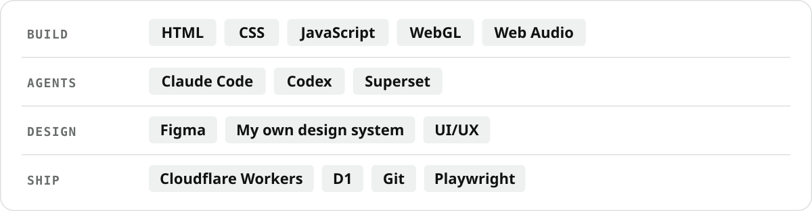

<picture>
  <source media="(prefers-color-scheme: dark)" srcset="assets/hero-dark.svg">
  
</picture>

<picture>
  <source media="(prefers-color-scheme: dark)" srcset="assets/h-work-dark.svg">
  
</picture>

<a href="https://staticade.com"><picture>
  <source media="(prefers-color-scheme: dark)" srcset="assets/staticade-dark.svg">
  
</picture></a>

<a href="https://staticade.com"><picture><source media="(prefers-color-scheme: dark)" srcset="assets/btn-play-dark.svg"></picture></a>
<a href="https://github.com/braxhughes/staticade#how-it-was-built"><picture><source media="(prefers-color-scheme: dark)" srcset="assets/btn-case-dark.svg"></picture></a>
<a href="https://github.com/braxhughes/staticade"><picture><source media="(prefers-color-scheme: dark)" srcset="assets/btn-source-dark.svg"></picture></a>

<picture>
  <source media="(prefers-color-scheme: dark)" srcset="assets/h-process-dark.svg">
  
</picture>

<picture>
  <source media="(prefers-color-scheme: dark)" srcset="assets/process-dark.svg">
  
</picture>

<picture>
  <source media="(prefers-color-scheme: dark)" srcset="assets/h-toolkit-dark.svg">
  
</picture>

<picture>
  <source media="(prefers-color-scheme: dark)" srcset="assets/toolkit-dark.svg">
  
</picture>

Learning HTML, CSS and JavaScript fundamentals in WSU Vancouver's Creative Media and Digital Culture program. Every project here says what I did and what the agents did.
